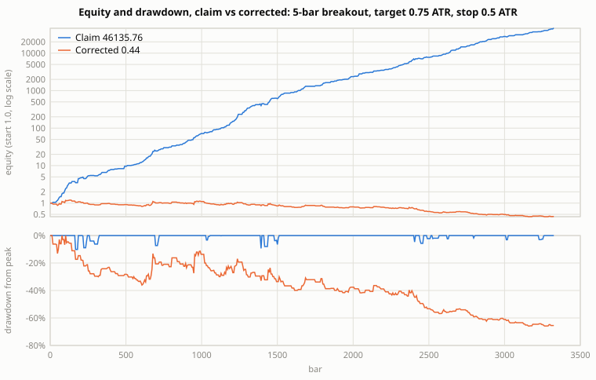
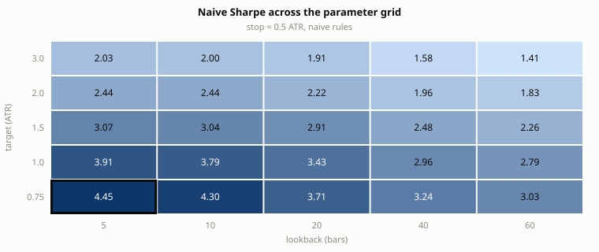

# Backtest methodology audit

Data: `data/btc_daily.csv`, 3326 daily bars. Strategy under review: long breakout above the 5-bar high, target 0.75 ATR, stop 0.5 ATR, time exit after 10 bars. These parameters are the best of 125 variants tried by the original backtest.

## The claim under review

The submitted backtest reports 370 trades, a 94.3% win rate, a total return of 4613475.9%, an annualized Sharpe ratio of 4.45 and a one-sided p-value of 2.8e-75 (t = 22.01). The audit below removes one methodological artifact at a time and reports what is left.

## Findings, artifact by artifact

| # | Artifact | Metric before | Metric after | Severity |
|---|---|---|---|---|
| 1 | Look-ahead: the signal uses the close of the bar it enters on | Sharpe 4.45 | Sharpe 0.50 | critical |
| 2 | Same-bar ambiguity resolved in favour of the target (18 of 365 exits) | Sharpe 0.50 | Sharpe 0.03 | material |
| 3 | Zero transaction costs (audit applies 20 bps round trip) | Sharpe 0.03 | Sharpe -0.33 | material |
| 4 | Overlapping 10-bar forward-return windows counted as independent | t = 3.61 on N = 407 | t = 2.12 (Newey-West), 2.09 (block bootstrap), effective N = 135 | material |
| 5 | Event returns tested against zero instead of the baseline | t vs 0 = 3.61 | t vs baseline = 1.28 (i.i.d.), 0.97 (Newey-West, p = 0.33), excess 0.8% per window | material: significance disappears |
| 6 | One-sided test chosen after seeing the sign | p = 0.456 | p = 0.911 (two-sided) | minor |
| 7 | Best of 125 variants reported without multiple-testing control | 12 variants significant at 5% | 0 after Benjamini-Hochberg; expected best Sharpe from noise alone 1.47; deflated-Sharpe probability 0.67 | material |
| 8 | Parameters optimized on the full sample, no holdout | in-sample Sharpe 0.90 (1995 bars) | holdout Sharpe 0.49 (1331 bars, touched once) | material |
| 9 | No random-entry control | strategy Sharpe 0.03 | 300 matched random-entry runs: mean -0.11, sd 0.26; strategy at the 68th percentile | material |
| 10 | Only the best parameter point is reported; the surface around it is hidden | reported variant Sharpe 4.45 (rank 1 of 125) | its 3 one-step neighbours: mean 4.16 (min 3.91, max 4.30); grid median 2.48; 66.7% of neighbours within 0.3 Sharpe | minor |

Rows 1-3 are corrections to the backtest itself and compound: after all three the honest Sharpe is -0.33. Rows 4-10 are corrections to the evidence: they do not change the returns, they change how much the returns prove.

## Risk and exposure, claim vs corrected

| Metric | Claim (as submitted) | Corrected (rows 1-3 applied) |
|---|---|---|
| Max drawdown | 10.1% over 57 bars | 65.9% over 3204 bars |
| Annualised volatility | 18.7% | 15.3% |
| Exposure (share of bars in a position) | 14.6% | 17.2% |
| Turnover (trades per year) | 28.0 | 27.7 |
| Worst day | -9.4% | -7.5% |
| Expected shortfall, worst 5% of days | -0.7% | -2.7% |

The corrected column is the same strategy with look-ahead removed, ambiguous bars booked to the stop and 20 bps charged per round trip; it is what the risk figures would have been had the backtest been built correctly.

## Charts

Both charts are generated by `python -m audit` as plain SVG; the equity panel compounds the daily mark-to-market returns from 1.0, the lower panel is the drawdown from the running peak.

## Material weaknesses

- Look-ahead is the largest single artifact: 3.96 Sharpe points come from knowing the close before entering.
- 18 exits are ambiguous within the bar; resolving them in the strategy's favour is worth 0.47 Sharpe points.
- With 20 bps of round-trip cost the Sharpe falls by 0.36; the claim assumes costless execution.
- The 407 signal windows are not independent: effective N is about 135, so the naive t-statistic overstates the evidence.
- Of 125 variants, 12 look significant at 5% (noise alone would produce about 6) and 0 survive FDR control; the best Sharpe of pure noise across that many trials would be about 1.47.
- The in-sample Sharpe of 0.90 becomes 0.49 on a holdout that was never used for selection.
- Random entries with the same trade count, holding periods and stop width reach the strategy's Sharpe in 32% of runs; the entry rule adds nothing measurable.
- The corrected run's maximum drawdown is 65.9% against 10.1% in the claim.

## Required corrections

- Compute every signal from information available at the decision time and enter at the next bar's open, or later; re-run the full grid under that rule before any other analysis.
- When a bar touches both target and stop, book the stop. If the order of touches matters to the strategy, the test needs intrabar data; daily bars cannot resolve it.
- Charge a documented round-trip cost (spread, slippage, commission) on every trade and report the cost assumption next to every performance figure.
- Report the effective sample size and a dependence-robust t-statistic (Newey-West or block bootstrap with blocks at least as long as the holding period) instead of the i.i.d. t-test.
- Test event returns against the unconditional baseline over the same horizon, not against zero, with the same dependence-robust standard errors: the baseline windows overlap too.
- Pre-register the hypothesis direction; use two-sided tests unless the direction was fixed before looking at the data.
- Control the family-wise or false-discovery rate across every variant tried, and report the deflated Sharpe ratio with the number of trials.
- Keep a confirmatory holdout that is touched exactly once, after the methodology is frozen.
- Compare against a matched random-entry control: same number of trades, same holding-period distribution, same stop width, per instrument.
- Report the parameter surface, not its maximum: the one-step neighbourhood and the grid distribution next to the chosen variant.
- Report maximum drawdown, exposure and turnover with every performance figure; a Sharpe ratio without them hides how the return was earned.

## Recommended methodology for the next pre-registered run

1. Freeze the rule set, the parameter grid, the cost model and the holdout boundary in a written pre-registration before running anything.
2. Split the history into a development sample and a confirmatory holdout; do all selection on the development sample only.
3. For every variant, record the Sharpe ratio, a dependence-robust t-statistic, the effective N and the number of ambiguous bars.
4. Select with Benjamini-Hochberg at q = 0.05 and report the deflated Sharpe ratio of the chosen variant against the full trial count.
5. Run the matched random-entry control on the development sample; a variant that does not beat the 95th percentile of the control does not proceed.
6. Run the surviving variant once on the holdout. Report it whatever the result; a second look at the holdout invalidates it.
7. Report the parameter neighbourhood of the surviving variant and its risk profile (drawdown, exposure, turnover) with the holdout result.

## Evidence required before confirmatory testing

- A signed pre-registration with the frozen rules, grid, cost model and holdout boundary.
- The development-sample table for every variant, with raw and FDR-adjusted p-values and the deflated Sharpe ratio.
- The random-entry control distribution and the chosen variant's percentile within it.
- An intrabar or tick-level check of same-bar exits if they exceed 1% of trades.
- A reproducibility run: the same numbers from a clean checkout with the recorded seed.

---

Generated by `python -m audit`. On real data the truth is unknown: the audit cannot say the edge is zero, only how much of the claim survives each correction and how much the baseline drift explains.
